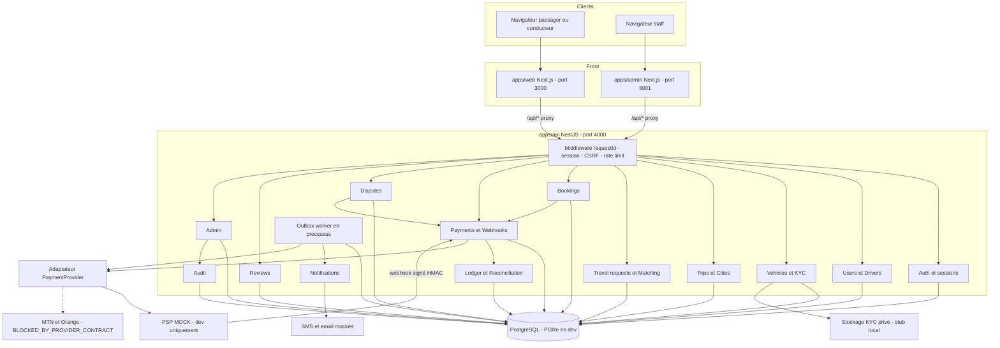
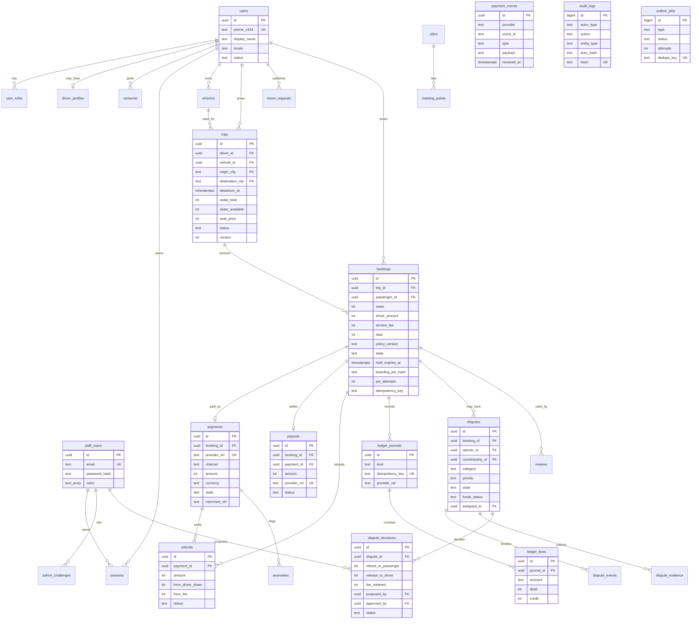
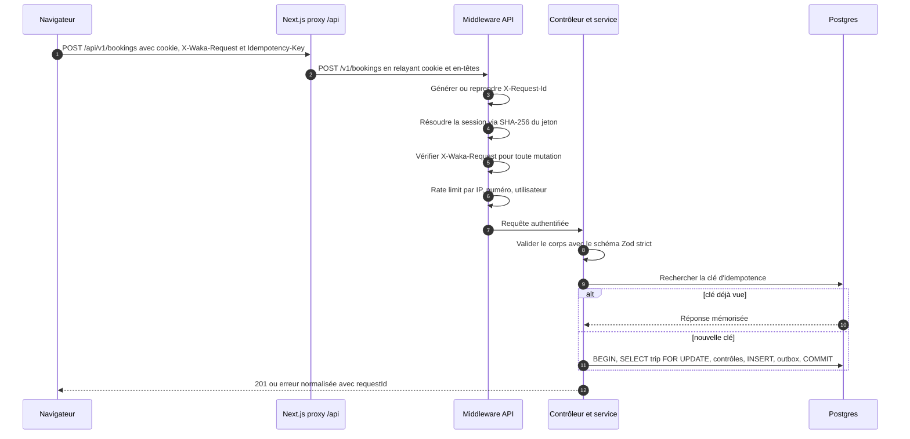
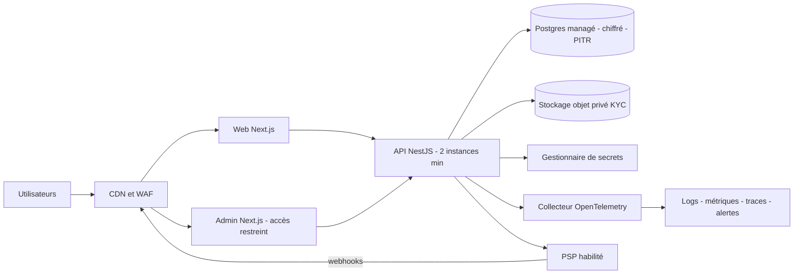

# Architecture — Waka

> Version de travail 0.1 — 21 novembre 2026. Ce document décrit l'architecture **conçue**. Les noms exacts de tables et de colonnes font foi dans les migrations de `apps/api` ; en cas d'écart, ce sont les migrations qui priment et ce document doit être corrigé.

## Résumé exécutif

- **Monolithe modulaire** NestJS (TypeScript strict) exposant une API REST `/v1`, consommée par deux front-ends Next.js séparés (`apps/web` pour passagers/conducteurs, `apps/admin` pour le staff), toujours via un **proxy même-origine**.
- **Règles métier pures** isolées dans `packages/domain` (machines d'états, ledger, allocations, matching, RBAC, contrat PSP) et **contrats d'API** partagés dans `packages/contracts` (schémas Zod `.strict()`).
- **PostgreSQL** comme unique source de vérité applicative : PGlite (Postgres embarqué) en dev/test, Postgres managé en production. Contraintes SQL explicites, verrous `SELECT … FOR UPDATE`, tables append-only.
- **Outbox transactionnelle** + worker en processus pour les effets de bord (notifications, appels PSP, expirations) ; Redis/BullMQ reporté (ADR-004).
- **PSP derrière une interface** `PaymentProvider` à capacités déclarées ; seul l'adaptateur MOCK fonctionne, en développement uniquement ; MTN/Orange sont `BLOCKED_BY_PROVIDER_CONTRACT`.
- Waka **ne détient jamais de fonds** : le ledger est un registre de rapprochement, le compte `psp_held` reflète des fonds détenus par le PSP.

## 1. Pourquoi un monolithe modulaire

| Critère | Monolithe modulaire | Microservices |
|---|---|---|
| Transactions réservation + paiement + ledger | Une transaction Postgres, atomicité native | Sagas distribuées, risques de double paiement |
| Audit et tests | Un seul déploiement à auditer, tests d'intégration simples | Surface d'attaque et de configuration multipliée |
| Équipe pilote (2 à 4 développeurs) | Adapté | Coût opérationnel disproportionné |
| Extraction future | Possible : modules à frontières explicites, événements outbox | — |

Décision détaillée : ADR-001 dans [`DECISIONS.md`](./DECISIONS.md).

## 2. Vue des composants

## 3. Arborescence et modules

| Chemin | Rôle |
|---|---|
| `packages/domain` | Règles pures, sans I/O : `money`, `pricing`, `state-machines`, `ledger`, `settlement`, `matching`, `rbac`, `payment-provider`, `phone`, `brand`, `errors`. Testées dans `packages/domain/test/domain.test.ts`. |
| `packages/contracts` | Schémas Zod d'entrée/sortie, catalogue `ROUTES`, en-têtes `Idempotency-Key` et `X-Waka-Request`. Aucun schéma d'entrée n'accepte un montant, un statut de paiement, une commission, un statut de vérification ou une destination de versement. |
| `apps/api` | NestJS + Drizzle ORM. Modules ci-dessous. |
| `apps/web` | Next.js App Router, PWA, FR/EN. |
| `apps/admin` | Next.js, console staff (login + MFA TOTP). |

| Module API | Responsabilité | Invariants portés |
|---|---|---|
| Auth | OTP +237, sessions opaques, login staff + MFA | OTP expirant, tentatives limitées, seul le SHA-256 du jeton est stocké |
| Users / Drivers | Profils, rôles, onboarding conducteur | Rôles attribués par le serveur uniquement |
| Vehicles / KYC | Véhicules, documents, décisions de revue | Aucun auto-marquage « vérifié » ; documents jamais exposés en URL publique |
| Cities | Villes et points de rendez-vous | Référentiel fermé (DLA, YDE, KRI, BFS, LIM, BUE, EDE, BAM) |
| Trips | Publication, annulation, départ, arrivée | Conducteur et véhicule éligibles à la date du trajet ; places ≤ capacité homologuée |
| Travel requests / Matching | Demandes passagers, scores expliqués | Formule versionnée, aucune réservation automatique |
| Bookings | Hold de places, PIN, confirmation passager | Zéro survente ; `CONFIRMED` seulement sur preuve PSP |
| Payments / Webhooks | Initiation, webhooks, réinterrogation PSP, versements, remboursements | Idempotence, anti-rejeu, contrôle montant/devise/marchand |
| Ledger / Reconciliation | Journaux en partie double, rapprochement quotidien | Append-only, équilibre par journal, écart = alerte |
| Disputes | Workflow contradictoire, preuves, décisions | Gel du paiement, proposant ≠ approbateur, allocation validée |
| Reviews | Avis après trajet | Un avis par réservation éligible |
| Notifications | Modèles, envoi, retries | Aucune donnée sensible dans les SMS |
| Admin | Endpoints `/v1/admin/*` | RBAC + ABAC + MFA récente pour actions sensibles |
| Audit | Journal chaîné par hachage | Append-only, vérifiable |
| Outbox worker | Consommation des événements | Retries bornés, quarantaine (dead-letter) |

## 4. Modèle de données

### 4.1 Diagramme entité-relation

Aligné sur `apps/api/migrations/0001_init.sql` (attributs principaux seulement).

Tables techniques non représentées : `otp_challenges`, `idempotency_records`, `reconciliation_runs`, `notifications`, `mock_psp_transactions` (état « côté prestataire » du PSP simulé, MOCK uniquement).

### 4.2 Contraintes clés (portées par la base)

| Domaine | Contrainte | Objectif |
|---|---|---|
| Identité | `users.phone_e164` unique avec `CHECK` sur le format `+2376XXXXXXXX` ; rôles utilisateurs limités à `PASSENGER`/`DRIVER`, rôles staff dans une table distincte `staff_users` | Aucune élévation vers un rôle staff via le compte public |
| Sessions | `token_sha256` unique ; `CHECK` exclusif utilisateur **ou** staff | Vol de base ≠ vol de session |
| OTP / MFA | `attempts BETWEEN 0 AND 5` sur `otp_challenges` et `admin_challenges` | Force brute bornée |
| KYC | `declares_private_carpool_only` obligatoirement vrai ; numéro de permis et plaque stockés hachés ; `id_document_ref` opaque, jamais exposé | Minimisation, pas d'URL publique |
| Places | `CHECK (seats_available >= 0 AND seats_available <= seats_total)` ; décrément sous `SELECT … FOR UPDATE` sur `trips` | Zéro survente |
| Snapshot de prix | `CHECK (total = driver_amount + service_fee)` et `CHECK (driver_amount = seat_price * seats)` ; `policy_version` stockée | Prix serveur cohérent et immuable |
| Idempotence | `UNIQUE (passenger_id, idempotency_key)` sur `bookings` ; `idempotency_records` en clé primaire `(user_id, route, key)` avec `request_hash` et réponse mémorisée | Même clé ⇒ même réponse ; clé réutilisée avec un autre corps détectable |
| PIN | `pin_attempts BETWEEN 0 AND 5` ; PIN stocké haché | Embarquement non devinable par essais |
| Paiement | `booking_id` unique, `provider_ref` unique, `CHECK (amount > 0)`, `CHECK (currency = 'XAF')`, `merchant_ref` obligatoire | Une collecte par réservation, contrôle marchand |
| Webhooks | `UNIQUE (provider, event_id)` sur `payment_events` (corps brut conservé) | Anti-rejeu |
| Versement | `payouts.booking_id` **unique** (MVP : un seul versement par réservation), `provider_ref` unique | Double versement impossible |
| Remboursement | `CHECK (from_driver_share + from_fee = amount)` ; trigger `refunds_within_payment` : somme des remboursements non échoués ≤ montant payé | Aucun remboursement au-delà du payé, même en cas de bogue applicatif |
| Ledger | `ledger_journals.idempotency_key` unique ; ligne strictement débit **ou** crédit ; comptes en liste fermée ; trigger différé `ledger_lines_balanced` (débit = crédit par journal, au commit) | Un événement économique = un journal équilibré |
| Append-only | Triggers `forbid_mutation` sur `ledger_journals`, `ledger_lines`, `audit_logs` (UPDATE, DELETE, TRUNCATE) | Correction uniquement par contre-écriture |
| Audit | `prev_hash` + `hash` unique : chaque entrée chaîne le hachage de la précédente | Toute altération casse la chaîne et devient détectable |
| Litiges | Index unique partiel : un seul litige non clos par réservation ; `CHECK (opener_id <> counterparty_id)` | Pas de dossiers parallèles contradictoires |
| Décisions | `CHECK (approved_by IS NULL OR approved_by <> proposed_by)` ; une seule décision `PROPOSED` et une seule `APPROVED` par litige (index partiels) | Séparation des tâches garantie par la base |
| Avis | `UNIQUE (booking_id, author_id)`, `CHECK (author_id <> subject_id)` | Un avis par réservation, pas d'auto-notation |
| Outbox | `dedupe_key` unique, statut `DEAD` après `max_attempts` | Pas d'effet en double, quarantaine visible |

Les données personnelles (purge, export) et les données financières (conservation légale) ont des **durées de conservation distinctes**, à fixer avec le juriste (Loi n°2024/017, voir [`LEGAL_GATES.md`](./LEGAL_GATES.md)).

## 5. Cycle de vie d'une requête

| Étape | Règle |
|---|---|
| `requestId` | Généré à l'entrée, renvoyé dans `X-Request-Id`, propagé dans chaque log et chaque erreur `{ error: { code, message, requestId, details? } }`. |
| Authentification | Cookies opaques `waka_session` (utilisateurs) et `waka_admin` (staff), `HttpOnly`, `SameSite=Lax`, `Secure` en production. Le staff passe obligatoirement par la MFA TOTP. |
| CSRF | Toute requête mutante doit porter `X-Waka-Request: 1`, sinon `403`. Seuls `/v1/webhooks/*` en sont exemptés (authentifiés par signature). |
| Autorisation | RBAC (`ROLE_PERMISSIONS`) + ABAC (propriété de l'objet, dossiers attribués) + MFA récente pour les permissions sensibles. |
| Validation | Schémas Zod `.strict()` : tout champ inattendu est rejeté (anti mass-assignment). |
| Idempotence | `Idempotency-Key` (UUID) obligatoire sur `POST /v1/bookings` et `POST /v1/bookings/:id/payments`. |
| Transactions | Toute mutation financière ou de stock s'exécute dans une transaction qui verrouille les lignes concernées et écrit l'événement outbox **dans la même transaction**. |

## 6. Outbox et traitements asynchrones

1. Un service métier écrit son changement d'état **et** une ligne `outbox_jobs` (avec `dedupe_key`) dans la même transaction.
2. Le worker en processus réclame des lots (`FOR UPDATE SKIP LOCKED` sur Postgres), exécute l'effet (SMS, appel PSP, expiration de hold), marque l'événement traité (`DONE`), ou `DEAD` après `max_attempts`.
3. Échec : backoff exponentiel borné, puis quarantaine (dead-letter) avec alerte.
4. Les gestionnaires sont idempotents (clé métier) : un rejeu ne crée jamais de second effet financier.

Migration prévue vers Redis/BullMQ si le volume ou l'exécution multi-instance le justifient (ADR-004).

## 7. Intégration PSP

- Interface `PaymentProvider` : `initiateCollection`, `getPaymentStatus`, `requestRelease`, `requestRefund`, `getPayoutStatus`, `reconcile`, `verifyWebhook`, avec `capabilities` déclarées (`conditionalHold`, `marketplacePayouts`, `partialRefund`, `fullRefund`, `signedWebhooks`, `statusQueryApi`, `reconciliationReport`, `channels`).
- Appeler une capacité non déclarée lève `FeatureNotSupported` : aucune capacité n'est supposée.
- `mode: 'MOCK' | 'SANDBOX' | 'LIVE'` ; l'API refuse de démarrer avec `PAYMENT_PROVIDER=mock` si `NODE_ENV=production`.
- Détails des flux : [`PAYMENT_FLOWS.md`](./PAYMENT_FLOWS.md).

## 8. Stockage KYC

- En développement : stub local dans un répertoire non servi, références opaques (`idDocumentUploadRef`), jamais d'URL publique.
- Cible : stockage objet compatible S3 **privé**, chiffrement au repos (clés gérées), antivirus et contrôle MIME/taille à l'upload, URLs signées de courte durée générées après contrôle d'accès et journalisées, purge programmée selon la durée de conservation validée.

## 9. Topologie de déploiement cible

Environnements isolés (dev, staging, prod), comptes cloud et secrets distincts. Détails : [`DEPLOYMENT.md`](./DEPLOYMENT.md).

## 10. Évolutions prévues

| Sujet | Déclencheur | Référence |
|---|---|---|
| PostGIS + itinéraires | Passage au matching sur trajet (FR-23) | ADR-010 |
| Redis/BullMQ | Plusieurs instances d'API ou volume d'événements soutenu | ADR-004 |
| Adaptateur PSP réel | Contrat signé + sandbox + tests de contrat | ADR-006 |
| Applications natives | Parcours validés au pilote (FR-24) | PRD |
