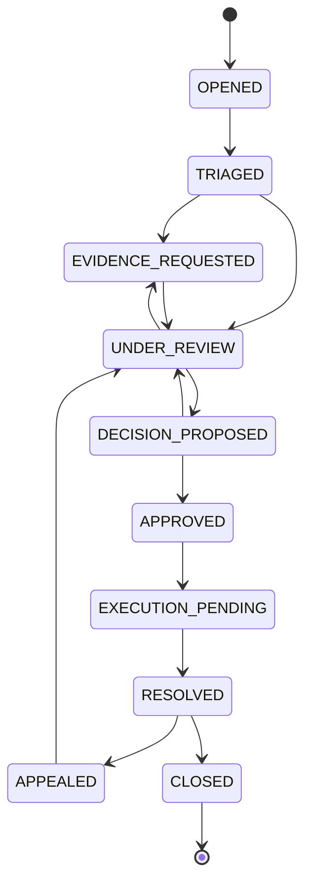

# Litiges — politique, workflow et communication

> Version de travail 0.1 — 21 novembre 2026. Source de vérité du code : `disputeMachine` (`packages/domain/src/state-machines.ts`), `validateAllocation` et `requiresSecondApproval` (`settlement.ts`), `canViewDispute` et `assertDistinctApprover` (`rbac.ts`). La politique publique destinée aux utilisateurs doit être relue par un juriste avant publication.

## Résumé exécutif

- Tout participant à une réservation peut ouvrir un litige ; l'ouverture **gèle immédiatement** le paiement concerné (`FROZEN_DISPUTE`) et bloque tout versement.
- Les dossiers de sûreté (violence, harcèlement, accident) sont **prioritaires et traités par un humain** ; l'application oriente d'abord vers les secours.
- Instruction **contradictoire** : chaque partie voit la chronologie, peut répondre et fournir des pièces ; la décision est motivée.
- **Séparation des tâches** : le support collecte mais ne décide pas ; une décision financière est proposée par un responsable litiges et approuvée par une **autre** personne habilitée (MVP : toute décision financière).
- **Allocation encadrée** : aucun remboursement au-delà du payé, rien n'est alloué deux fois, la plateforme ne garde jamais la part conducteur.
- Un litige n'est `RESOLVED` qu'après **preuve d'exécution par le PSP**. Un recours interne est possible.
- Waka **n'est ni un tribunal ni la police** : il décide dans les limites contractuelles et transmet aux autorités lorsque c'est requis.

## 1. Catégories et priorités

| Code | Libellé utilisateur | Priorité par défaut (règle proposée) |
|---|---|---|
| `DANGEROUS_BEHAVIOUR` | Comportement dangereux | **SAFETY** |
| `THEFT_ASSAULT_HARASSMENT` | Vol, agression ou harcèlement | **SAFETY** |
| `ACCIDENT` | Accident | **SAFETY** |
| `DRIVER_NO_SHOW` | Conducteur absent | HIGH |
| `WRONG_IDENTITY_OR_VEHICLE` | Mauvaise identité ou mauvais véhicule | HIGH |
| `PAYMENT_ISSUE` | Paiement non reconnu ou erroné | HIGH |
| `PAYOUT_ISSUE` | Impossibilité de recevoir le versement | HIGH |
| `PASSENGER_NO_SHOW` | Passager absent | NORMAL |
| `CANCELLATION` | Annulation contestée | NORMAL |
| `EXCESSIVE_DELAY` | Retard excessif | NORMAL |
| `DROPOFF_NOT_RESPECTED` | Point de dépôt non respecté | NORMAL |
| `TRIP_QUALITY` | Qualité du trajet | NORMAL |
| `LUGGAGE` | Bagages | NORMAL |

Règles de priorité :
1. `urgentSafety = true` à l'ouverture ⇒ **SAFETY**, quelle que soit la catégorie.
2. SAFETY ⇒ notification immédiate de l'astreinte, affichage des numéros d'urgence, gel du paiement, aucune automatisation de décision.
3. Le triage humain peut relever une priorité, jamais abaisser une priorité SAFETY sans motif écrit audité.
4. À priorité égale : échéance la plus proche, puis montant le plus élevé.

## 2. Machine d'états

Diagramme strictement aligné sur `disputeMachine`.

| État | Ce qui se passe | Effet financier |
|---|---|---|
| `OPENED` | Catégorie, récit (20 à 2 000 caractères), issue demandée, urgence | Paiement → `FROZEN_DISPUTE`, réservation → `DISPUTED` |
| `TRIAGED` | Priorité confirmée, dossier attribué | Gel maintenu |
| `EVIDENCE_REQUESTED` | Demande ciblée à une partie ou aux deux, délai de 12 à 168 h | Gel maintenu |
| `UNDER_REVIEW` | Chronologie, embarquement PIN, horodatages, transactions PSP, réponses | Gel maintenu |
| `DECISION_PROPOSED` | Allocation + motif (≥ 20 caractères) | Allocation validée par `validateAllocation` |
| `APPROVED` | Seconde personne habilitée, MFA récente | Instructions PSP préparées |
| `EXECUTION_PENDING` | Instructions envoyées au PSP | Attente des confirmations |
| `RESOLVED` | Toutes les exécutions PSP confirmées | Journaux ledger écrits |
| `APPEALED` | Recours d'une partie dans la fenêtre annoncée | Nouvel examen, aucune exécution supplémentaire sans nouvelle allocation valide |
| `CLOSED` | Dossier clos, conservation selon obligations légales | — |

Litige ouvert après un versement déjà confirmé ou en cours : le dossier est instruit normalement, mais son état de fonds (`funds_status` : `ALREADY_RELEASED` ou `RELEASE_IN_FLIGHT`) est affiché aux deux parties ; aucun gel n'est alors possible et l'issue ne peut prendre que la forme d'un geste commercial distinct ou d'une orientation vers les voies de droit.

Rejet d'une proposition : `DECISION_PROPOSED → UNDER_REVIEW` avec motif (`POST /v1/admin/disputes/:id/reject`).

## 3. Rôles et séparation des tâches

| Action | Support | Responsable litiges | Finance | Superadmin |
|---|:-:|:-:|:-:|:-:|
| Voir un dossier | Attribués uniquement | Tous | — | Tous (lecture) |
| Demander des pièces | ✔ | ✔ | — | — |
| Proposer une décision | ✘ | ✔ (MFA) | ✘ | ✘ |
| Approuver une décision | ✘ | ✔ si ≠ proposant (MFA) | ✔ si ≠ proposant (MFA) | ✘ |
| Exécuter un versement « manuel » | ✘ | ✘ | ✘ | ✘ |

- `assertDistinctApprover` : l'approbateur doit être différent du proposant (`SEPARATION_OF_DUTIES`).
- `requiresSecondApproval` : seuil MVP à 0 FCFA, donc **toute** décision financière exige une seconde approbation.
- Conflit d'intérêts : un membre du staff ne traite pas un dossier impliquant une personne qu'il connaît ; déclaration obligatoire, réattribution.
- Chaque action est inscrite au journal d'audit chaîné (qui, quoi, quand, pourquoi, avant/après).

## 4. Preuves et vie privée

| Règle | Détail |
|---|---|
| Proportionnalité | On ne demande que ce qui est utile à la décision (ex. photo du point de rendez-vous, capture d'un échange interne) |
| Sources privilégiées | Données serveur : horodatages d'embarquement PIN, signalement d'arrivée, statuts PSP, messages internes |
| Fichiers | Contrôle MIME et taille, antivirus, stockage privé, accès via URL signée courte, consultation journalisée |
| Visibilité | Chaque partie voit le récit et les pièces de l'autre, **à l'exception** des données personnelles non nécessaires (numéro complet, pièces d'identité, adresse) |
| Localisation | Uniquement si partagée volontairement et limitée à la durée du trajet |
| Conservation | Durée à fixer avec le juriste (Loi n°2024/017), distincte de la conservation des données financières |
| Autorités | Transmission uniquement sur réquisition légale ou obligation, après validation juridique |

Une position GPS ou une capture d'écran isolée ne suffit pas, à elle seule, à trancher un no-show : la décision combine plusieurs éléments.

## 5. Règles d'allocation

`validateAllocation(position, { refundToPassenger, releaseToDriver })` :

| Règle | Erreur si violée |
|---|---|
| Montants entiers ≥ 0 | `INVALID_AMOUNT` |
| Montant capturé = part conducteur + frais du snapshot | `AMOUNT_MISMATCH` |
| Aucune allocation déjà engagée | `ALREADY_EXECUTED` |
| Remboursement + versement ≤ montant payé | `ALLOCATION_EXCEEDED` |
| Versement ≤ part conducteur | `ALLOCATION_EXCEEDED` |
| Part conducteur non versée ⇒ remboursée au passager (la plateforme ne la garde jamais) | `ALLOCATION_EXCEEDED` |
| Remboursement imputé sur les frais ≤ frais payés | `ALLOCATION_EXCEEDED` |

Exemples sur un paiement de 5 500 FCFA (5 000 conducteur + 500 frais) :

| Décision | Remboursement passager | Versement conducteur | Frais retenus | Valide ? |
|---|---:|---:|---:|:-:|
| Conducteur absent | 5 500 | 0 | 0 | ✔ |
| Trajet accompli, réclamation non fondée | 0 | 5 000 | 500 | ✔ |
| Trajet interrompu à mi-parcours | 2 500 | 3 000 | 0 | ✔ |
| Retard, geste partiel | 500 | 5 000 | 0 | ✔ |
| Plateforme garde la part conducteur | 0 | 0 | 5 500 | ✘ |
| Remboursement supérieur au payé | 6 000 | 0 | — | ✘ |

Les **crédits commerciaux** éventuels (gestes de Waka sur ses propres fonds) sont distincts des fonds clients et ne passent jamais par l'allocation du paiement litigieux.

## 6. SLA cibles (à contractualiser)

| Étape | Cible | Remarque |
|---|---|---|
| Accusé de réception | Immédiat (automatique) | Message et numéro de dossier |
| Dossier SAFETY | Prise en charge humaine prioritaire ; disponibilité 24/7 à organiser avant pilote | Ne remplace pas les secours |
| Premier examen standard | Sous 24 h ouvrées | |
| Décision, dossier complet | 3 à 5 jours ouvrés | Délai expliqué si dossier complexe |
| Fenêtre de recours | À fixer (proposition : 7 jours après la décision) | À valider juridiquement |

Ce sont des **objectifs**, pas des garanties. Un délai dépassé **n'autorise jamais** la libération automatique d'un paiement gelé.

## 7. Recours

- Ouvert à chaque partie depuis l'état `RESOLVED`, une fois, dans la fenêtre annoncée (`POST /v1/disputes/:id/appeal`).
- Réexamen par une personne différente de celle qui a proposé la décision initiale.
- Si l'allocation initiale a déjà été exécutée par le PSP, le recours ne peut produire qu'un geste commercial distinct ou une orientation vers les voies de droit ; il ne crée pas de seconde exécution sur le même paiement.
- Les voies de recours externes (médiation, juridiction compétente) sont précisées dans les CGU, après validation juridique.

## 8. Modèles de communication

Ton : empathique, factuel, sans jugement, sans promesse de résultat. Les messages SMS ne contiennent aucune donnée sensible ; le détail est consultable dans l'application.

| État | Au passager | Au conducteur |
|---|---|---|
| `OPENED` (ouvert par le passager) | « Nous avons bien reçu votre signalement (dossier W-1234). Le règlement de ce trajet est suspendu le temps de l'examen. Vous pouvez ajouter des éléments à tout moment depuis l'application. » | « Le passager de votre trajet du 28 nov. a signalé un problème (dossier W-1234). Le versement est suspendu pendant l'examen. Votre version compte : vous pourrez la donner dans l'application. » |
| `OPENED` (ouvert par le conducteur) | « Le conducteur de votre trajet a signalé un problème (dossier W-1234). Nous examinons la situation de manière contradictoire ; vous pourrez donner votre version dans l'application. » | « Nous avons bien reçu votre signalement (dossier W-1234). Nous revenons vers vous rapidement. » |
| `OPENED` priorité SAFETY | « Votre sécurité passe avant tout. Si vous êtes en danger, appelez immédiatement les secours. Un membre de notre équipe prend votre dossier en charge en priorité. » | « Un signalement de sécurité concerne votre trajet. Un membre de notre équipe va vous contacter. Le versement est suspendu pendant l'examen. » |
| `TRIAGED` | « Votre dossier est pris en charge par notre équipe. Prochaine étape : examen des éléments. » | Idem |
| `EVIDENCE_REQUESTED` | « Pour avancer, nous avons besoin d'un élément de votre part : [demande]. Vous avez jusqu'au [date] pour répondre. Sans réponse, nous déciderons avec les éléments disponibles. » | Idem |
| `UNDER_REVIEW` | « Nous examinons l'ensemble des éléments transmis par chacun. Délai visé : [date]. » | Idem |
| `DECISION_PROPOSED` | (pas de notification : décision interne en attente d'approbation) | Idem |
| `APPROVED` / `EXECUTION_PENDING` | « Notre décision : [résumé et motif]. Un remboursement de [montant] FCFA a été demandé à notre partenaire de paiement. Nous vous confirmerons sa réception. » | « Notre décision : [résumé et motif]. Un versement de [montant] FCFA a été demandé à notre partenaire de paiement. Nous vous confirmerons son exécution. » |
| `RESOLVED` | « Le remboursement de [montant] FCFA est confirmé par notre partenaire de paiement. Si vous n'êtes pas d'accord, vous pouvez demander un réexamen jusqu'au [date]. » | « Le versement de [montant] FCFA est confirmé par notre partenaire de paiement. Si vous n'êtes pas d'accord, vous pouvez demander un réexamen jusqu'au [date]. » |
| `APPEALED` | « Votre demande de réexamen est enregistrée. Une autre personne de l'équipe va étudier le dossier. » | « L'autre partie a demandé un réexamen. Vous pourrez de nouveau apporter des éléments. » |
| `CLOSED` | « Votre dossier W-1234 est clos. Merci pour votre patience. » | Idem |

Formulations à éviter : « Nous avons retenu votre argent », « Vous avez tort », « Remboursé » avant confirmation PSP, toute promesse de délai garanti.

## 9. Ce que Waka n'est pas — et consignes d'urgence

- Waka **n'est pas un tribunal** : ses décisions sont contractuelles et opérationnelles, dans le cadre des CGU et du contrat PSP. Elles ne privent personne de ses recours légaux.
- Waka **n'est pas la police** : il ne mène pas d'enquête pénale, ne détient personne, ne remplace pas une plainte.
- En cas de danger immédiat, l'application affiche **en premier** les numéros d'urgence, avant tout formulaire.

| Service | Numéro usuellement cité | Statut |
|---|---|---|
| Police secours | 117 | **À vérifier** auprès des autorités avant publication |
| Sapeurs-pompiers | 118 | **À vérifier** |
| Gendarmerie | 113 | **À vérifier** |
| Urgences médicales | 119 | **À vérifier** |

Ces numéros ne doivent pas être publiés dans l'application sans vérification auprès d'une source officielle camerounaise (ministères compétents, autorités locales). Tant qu'ils ne sont pas vérifiés, l'écran affiche une consigne générique « Contactez immédiatement les secours et les forces de l'ordre ».
