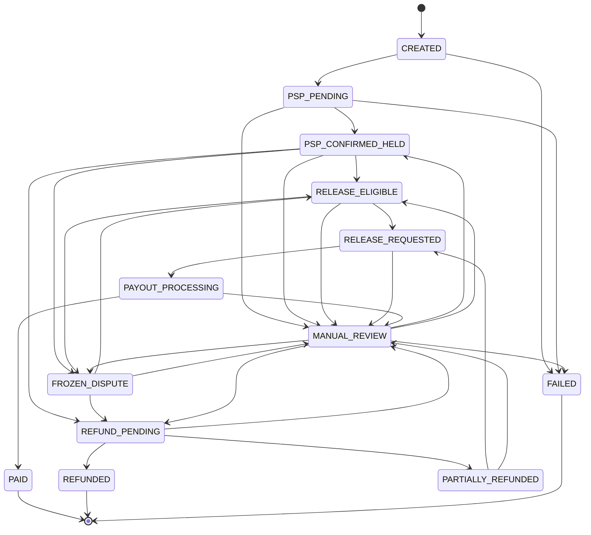
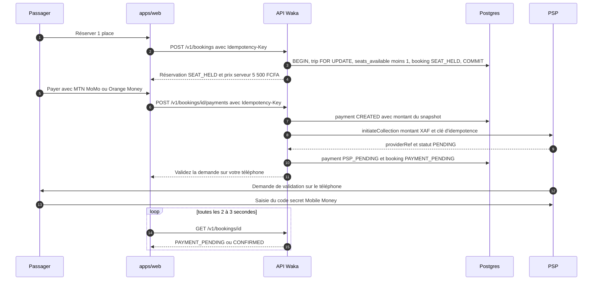
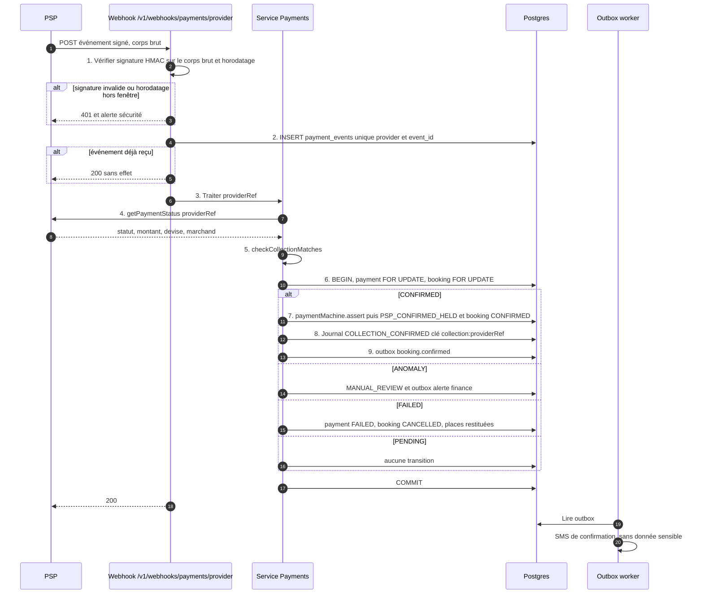
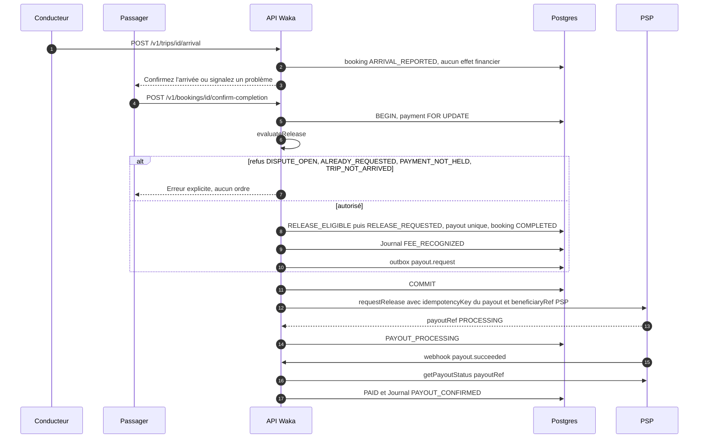
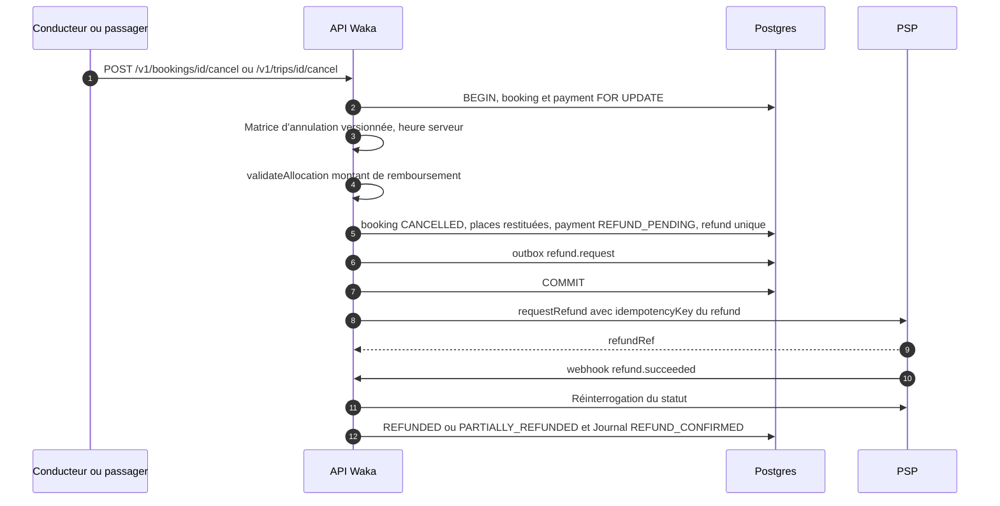
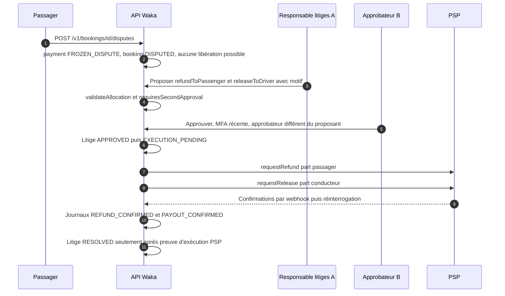

# Flux de paiement — le cœur financier de Waka

> Version de travail 0.1 — 21 novembre 2026. Source de vérité du code : `packages/domain/src/state-machines.ts`, `ledger.ts`, `settlement.ts`, `pricing.ts`, `payment-provider.ts`. Tout écart entre ce document et ces fichiers est un défaut à corriger.
> **Aucun flux décrit ici n'est actif avec de l'argent réel.** Seul l'adaptateur `MOCK` fonctionne, en développement ; les adaptateurs MTN MoMo et Orange Money sont `BLOCKED_BY_PROVIDER_CONTRACT`.

## Résumé exécutif

1. **Waka ne détient jamais les fonds des clients.** Le passager paie un PSP agréé/habilité ; la retenue conditionnelle, le reversement et le remboursement sont exécutés **par le PSP**, dans le cadre de son contrat. On parle de « retenue conditionnelle gérée par un PSP habilité », jamais d'« escrow Waka ».
2. Waka produit des **instructions autorisées** (libérer, rembourser) et tient un **ledger en partie double append-only** qui sert de registre de rapprochement ; la vérité des mouvements réels reste le PSP.
3. Une réservation ne devient `CONFIRMED` qu'après : webhook signé vérifié → dédoublonnage → **réinterrogation du PSP** → contrôle montant/devise/marchand → transaction verrouillée → écriture ledger → événement outbox.
4. Le versement au conducteur exige la **confirmation explicite du passager**, l'absence de litige ouvert et un paiement effectivement détenu par le PSP. Le clic « arrivé » du conducteur ne suffit jamais.
5. Un litige **gèle** le paiement concerné. Toute allocation passe par `validateAllocation` : rien n'est alloué deux fois, aucun remboursement ne dépasse le payé, la plateforme ne conserve jamais la part conducteur.
6. Si le PSP retenu ne sait pas faire la retenue conditionnelle et les versements multi-bénéficiaires, **la fonctionnalité est bloquée** et le parcours doit être adapté (voir §10).

## 1. Acteurs et responsabilités

| Acteur | Rôle dans le flux | Ce qu'il ne fait jamais |
|---|---|---|
| Passager | Initie le paiement depuis son téléphone (MoMo / Orange Money), confirme l'arrivée ou ouvre un litige | Ne fixe ni le prix ni le statut |
| Conducteur | Signale l'arrivée | Ne déclenche jamais seul un versement |
| Waka (API) | Calcule le prix, crée les instructions, vérifie les confirmations, tient le ledger, rapproche | Ne conserve pas de fonds, ne vire pas hors PSP |
| PSP habilité | Encaisse, conserve/cantonne, verse, rembourse, notifie, fournit les relevés | — |
| Staff (litiges, finance) | Propose et approuve des allocations dans le workflow | N'écrit jamais directement dans le ledger ; aucune permission « payer le conducteur » |

## 2. Prix et snapshot

- Calcul **exclusivement serveur** par `quote(seatPrice, seats, policy)` ; aucun schéma d'entrée n'accepte de montant.
- Politique par défaut `fees-2026-11-v1` (hypothèse non contractuelle) : 500 FCFA de frais par place, plafond 2 000 FCFA par place ; contribution de 500 à 50 000 FCFA, multiple de 50 ; 1 à 4 places.
- La réservation fige `policyVersion`, `driverAmount`, `serviceFee`, `total` ; un changement de politique n'affecte jamais une réservation existante.

## 3. Machine d'états du paiement

Diagramme strictement aligné sur `paymentMachine` (29 transitions ; toute autre transition lève `INVALID_TRANSITION`).

Libellés affichés (`PAYMENT_STATE_LABEL_FR`) — « demandé » n'est jamais confondu avec « confirmé » :

| État | Libellé utilisateur | Signification |
|---|---|---|
| `CREATED` | Paiement en préparation | Instruction créée, PSP pas encore sollicité |
| `PSP_PENDING` | Paiement en cours de vérification | Demande envoyée au PSP, en attente de validation sur le téléphone |
| `PSP_CONFIRMED_HELD` | Fonds gérés par notre partenaire de paiement | Encaissement confirmé et vérifié ; fonds chez le PSP |
| `RELEASE_ELIGIBLE` | Versement possible après confirmation | Conditions de libération réunies |
| `RELEASE_REQUESTED` | Versement demandé | Instruction envoyée au PSP |
| `PAYOUT_PROCESSING` | Versement en cours chez le partenaire | Le PSP traite le versement |
| `PAID` | Versement confirmé | Le PSP a confirmé le décaissement |
| `FAILED` | Paiement échoué | Encaissement échoué ou abandonné |
| `FROZEN_DISPUTE` | Litige en cours : règlement suspendu | Gel lié au litige |
| `REFUND_PENDING` | Remboursement demandé | Instruction de remboursement envoyée |
| `PARTIALLY_REFUNDED` | Remboursement partiel confirmé | Le reliquat suit le chemin de versement |
| `REFUNDED` | Remboursement confirmé | Le PSP a confirmé le remboursement intégral |
| `MANUAL_REVIEW` | Vérification manuelle en cours | Anomalie, non-réponse passager ou incident technique |

> **Point ouvert de modélisation.** Après un remboursement partiel où la part conducteur versée est nulle (ex. `releaseToDriver = 0`, frais retenus), l'état `PARTIALLY_REFUNDED` n'a pas de reliquat à verser mais n'est pas terminal. Règle proposée : orienter ce cas vers `REFUNDED` dès que le reliquat conducteur est nul, ou ajouter une transition explicite et testée. À trancher avant la phase « Argent sécurisé ».

### Couplage réservation ↔ paiement

| Événement | Réservation (`bookingMachine`) | Paiement (`paymentMachine`) |
|---|---|---|
| Places retenues | `DRAFT → SEAT_HELD` | — |
| Paiement initié | `SEAT_HELD → PAYMENT_PENDING` | `CREATED → PSP_PENDING` |
| Encaissement vérifié | `PAYMENT_PENDING → CONFIRMED` | `PSP_PENDING → PSP_CONFIRMED_HELD` |
| Échec d'encaissement / hold expiré | `→ CANCELLED` | `→ FAILED` |
| Embarquement PIN | `CONFIRMED → CHECKED_IN` | — |
| Départ / arrivée | `→ IN_PROGRESS → ARRIVAL_REPORTED` | — |
| Confirmation passager | `→ COMPLETED` | `→ RELEASE_ELIGIBLE → RELEASE_REQUESTED → PAYOUT_PROCESSING → PAID` |
| Litige ouvert | `→ DISPUTED` | `→ FROZEN_DISPUTE` |
| Annulation avant départ | `CONFIRMED → CANCELLED` | `PSP_CONFIRMED_HELD → REFUND_PENDING → REFUNDED` |

## 4. Encaissement

Règles :
- Le hold de places a une expiration courte (`hold_expires_at`) ; à l'expiration, un job outbox annule la réservation et restitue les places.
- Le front n'affiche « Réservation confirmée » que si l'API renvoie `CONFIRMED`. Un retour de redirection ou un message navigateur n'a **aucune** valeur de preuve.
- Une coupure réseau côté passager n'entraîne aucun double débit : la même `Idempotency-Key` renvoie le même paiement, et le PSP reçoit la même clé.

## 5. Traitement d'un webhook

| Étape | Contrôle | Échec ⇒ |
|---|---|---|
| 1 | Signature sur le **corps brut** (pas sur le JSON re-sérialisé), horodatage dans la fenêtre | `401 INVALID_SIGNATURE`, alerte |
| 2 | `UNIQUE (provider, provider_event_id)` | Rejeu ignoré (`200`), aucun effet |
| 4 | Réinterrogation PSP : le webhook n'est qu'un signal | Si PSP injoignable : pas de transition, retry outbox |
| 5 | `checkCollectionMatches` : statut `SUCCEEDED`, `currency === 'XAF'`, montant exact, `merchantRef` attendu | `ANOMALY` ⇒ `MANUAL_REVIEW`, **jamais** `CONFIRMED` |
| 6–7 | Verrous et `assert` de transition | Transition invalide refusée (ex. confirmation tardive d'une réservation annulée) |
| 8 | Journal à clé unique | Doublon impossible |

Événements hors ordre : un `collection.failed` arrivant après une confirmation vérifiée ne fait pas régresser l'état (transition non déclarée) ; il est journalisé et signalé. Une **confirmation tardive** sur une réservation déjà `CANCELLED` (hold expiré) conduit le paiement en `PSP_CONFIRMED_HELD` puis en `REFUND_PENDING` (remboursement intégral), ou en `MANUAL_REVIEW` si le PSP ne déclare pas `fullRefund`.

## 6. Confirmation passager → libération → versement

- `evaluateRelease` exige : aucun litige ouvert, aucun versement déjà demandé, paiement en `PSP_CONFIRMED_HELD` ou `RELEASE_ELIGIBLE`, réservation en `CHECKED_IN`, `IN_PROGRESS` ou `ARRIVAL_REPORTED`, **et** `passengerConfirmed`.
- Une double confirmation renvoie `ALREADY_REQUESTED` : un seul ordre de versement.
- Le ledger n'enregistre le versement qu'à la **confirmation PSP** (`PAYOUT_CONFIRMED`), jamais à la demande.
- Silence du passager : `noResponseOutcome` renvoie `WAIT` puis `MANUAL_REVIEW` après la fenêtre (48 h par défaut). La libération automatique est **désactivée** (`autoReleaseEnabled: false`, `legallyValidatedRef: null`) tant qu'un juriste et le PSP ne l'ont pas validée (ADR-007). Le conducteur n'est pas laissé sans recours : la revue manuelle est tracée et soumise à SLA.

## 7. Annulation et remboursement

Matrice d'annulation **souhaitée, à valider juridiquement et avec le PSP** :

| Situation | Politique proposée | Contrôles |
|---|---|---|
| Conducteur annule avant le départ | Remboursement intégral, frais inclus | Motif, sanctions en cas de récidive |
| Conducteur absent au départ | Remboursement intégral après vérification | Éléments contradictoires (litige `DRIVER_NO_SHOW`) |
| Passager annule tôt | Remboursement élevé ou intégral selon seuil publié | Heure serveur, politique acceptée au paiement |
| Passager annule tard | Barème annoncé et plafonné | Circonstances exceptionnelles |
| Passager absent | Règle contradictoire vérifiable | Point de rendez-vous, délai de grâce, preuves |
| Incident de sûreté | Gel immédiat, examen prioritaire | Support, coopération avec les autorités si nécessaire |
| Trajet partiellement accompli | Examen individualisé, remboursement partiel possible | Journal des étapes, accord PSP |

## 8. Litige : gel et remboursement partiel

Exemple : trajet interrompu à mi-parcours, décision « 3 000 FCFA au conducteur, 2 500 FCFA au passager ».
`validateAllocation({captured: 5500, driverAmount: 5000, serviceFee: 500, refunded: 0, released: 0}, {refundToPassenger: 2500, releaseToDriver: 3000})` ⇒ `refundFromDriverShare = 2000`, `refundFromFee = 500`, `feeRetained = 0`.

Règles de `validateAllocation` :
- montants entiers ≥ 0 ; `captured = driverAmount + serviceFee` ;
- aucune allocation déjà engagée (`refunded` ou `released` > 0 ⇒ `ALREADY_EXECUTED`) ;
- `refund + release ≤ captured` ; `release ≤ driverAmount` ;
- **toute part conducteur non versée est remboursée au passager** : la plateforme ne la conserve jamais ;
- seuls les frais de service peuvent être retenus (`feeRetained`), dans la limite des frais payés.

La décision de litige et l'instruction PSP ont des statuts **indépendants** : une décision approuvée dont l'exécution PSP échoue reste en `EXECUTION_PENDING` et passe en `MANUAL_REVIEW` côté paiement.

## 9. Ledger en partie double

### 9.1 Comptes (`LEDGER_ACCOUNTS`)

| Compte | Nature | Solde attendu en fin de cycle |
|---|---|---|
| `psp_held` | Miroir des fonds détenus **par le PSP** pour le compte des bénéficiaires | Égal aux frais acquis non encore reversés à Waka par le PSP |
| `driver_payable` | Part due au conducteur, conditionnelle | 0 |
| `platform_fee_deferred` | Frais encaissés mais non acquis | 0 |
| `platform_fee_revenue` | Frais acquis (trajet accompli ou décision) | Revenu brut |
| `adjustments` | Écarts de rapprochement sous investigation | 0 après résolution |

### 9.2 Modèles de journaux (`Journals`)

| Journal | Clé d'idempotence | Débit | Crédit | Déclencheur |
|---|---|---|---|---|
| `COLLECTION_CONFIRMED` | `collection:<pspRef>` | `psp_held` (total) | `driver_payable` (part conducteur), `platform_fee_deferred` (frais) | Encaissement vérifié |
| `FEE_RECOGNIZED` | `fee:<bookingId>` | `platform_fee_deferred` | `platform_fee_revenue` | Trajet accompli / décision |
| `PAYOUT_CONFIRMED` | `payout:<payoutRef>` | `driver_payable` | `psp_held` | Confirmation PSP du versement |
| `REFUND_CONFIRMED` | `refund:<refundRef>` | `driver_payable` et/ou `platform_fee_deferred` | `psp_held` | Confirmation PSP du remboursement |
| `REVERSAL` | `reversal:<clé d'origine>` | Lignes inversées | Lignes inversées | Seul moyen de corriger |
| `RECONCILIATION_ADJUSTMENT` | Clé du dossier d'écart | Selon investigation | `adjustments` ou inverse | Après investigation documentée |

Chaque journal est vérifié par `assertBalanced` : au moins deux lignes, chaque ligne strictement débit **ou** crédit, montants entiers positifs, total débit = total crédit. Aucune ligne n'est modifiée ou supprimée (triggers append-only).

### 9.3 Exemple chiffré : 5 000 + 500 = 5 500 FCFA

| # | Journal | `psp_held` | `driver_payable` | `platform_fee_deferred` | `platform_fee_revenue` |
|---|---|---:|---:|---:|---:|
| 1 | Encaissement confirmé | Dr 5 500 | Cr 5 000 | Cr 500 | |
| 2 | Frais acquis | | | Dr 500 | Cr 500 |
| 3 | Versement confirmé | Cr 5 000 | Dr 5 000 | | |
| | **Solde (débit − crédit)** | **+500** | **0** | **0** | **−500** |

Lecture : le conducteur a reçu 5 000 FCFA ; 500 FCFA de frais sont acquis par Waka mais encore détenus par le PSP jusqu'au reversement contractuel sur le compte marchand de Waka.

**Frais PSP hypothétiques de 100 FCFA.** Le domaine actuel ne modélise pas encore les frais PSP. Extension proposée (non implémentée), à activer seulement lorsque la grille réelle du PSP sera connue :

| Journal proposé | Débit | Crédit |
|---|---|---|
| `PSP_FEE_CHARGED` (`pspfee:<pspRef>`) | `psp_fees_expense` 100 | `psp_held` 100 |

Contribution avant autres charges : 500 − 100 = **400 FCFA**, hors TVA et fiscalité (à valider avec un fiscaliste).

**Remboursement intégral (le conducteur annule)** : Dr `driver_payable` 5 000, Dr `platform_fee_deferred` 500 / Cr `psp_held` 5 500 ⇒ tous les soldes à 0.

**Litige partiel (§8)** : `REFUND_CONFIRMED` Dr `driver_payable` 2 000, Dr `platform_fee_deferred` 500 / Cr `psp_held` 2 500 ; puis `PAYOUT_CONFIRMED` Dr `driver_payable` 3 000 / Cr `psp_held` 3 000 ⇒ tous les soldes à 0.

## 10. Rapprochement

| Étape | Description |
|---|---|
| Fréquence | Quotidienne (J+1, fuseau Africa/Douala) via le worker, et à la demande (`POST /v1/admin/finance/reconciliation/run`, permission `finance:reconcile`, MFA) |
| Source | `provider.reconcile(day)` : lignes `COLLECTION`, `PAYOUT`, `REFUND` avec `providerRef`, montant, statut |
| Comparaison | Ligne à ligne par `providerRef`, puis totaux par type (`providerTotals` vs `ledgerTotals`) |
| Écarts types | Réussi côté PSP mais absent du ledger ; présent au ledger mais inconnu du PSP ; montant différent ; statut divergent ; paiement `PSP_PENDING` depuis plus de N heures sans callback |
| Résultat | `MATCHED`, `DISCREPANCY` ou `NOT_RUN` (`ReconciliationOutput`) |
| Réaction | Alerte finance immédiate ; **blocage des libérations** des réservations concernées ; investigation ; correction uniquement par contre-écriture ou `RECONCILIATION_ADJUSTMENT` documenté et approuvé |
| Exports | CSV pour la finance (`finance:export`, MFA) |

Alertes à configurer : rapprochement non exécuté, écart > 0 FCFA, paiement sans callback au-delà du seuil, file outbox en quarantaine, taux d'échec de signature anormal.

## 11. Stratégie d'idempotence

| Niveau | Mécanisme |
|---|---|
| HTTP client → API | `Idempotency-Key` (UUID) obligatoire sur `POST /v1/bookings` et `POST /v1/bookings/:id/payments` ; même clé + même utilisateur ⇒ même réponse |
| API → PSP | Clé d'idempotence transmise à `initiateCollection`, `requestRelease`, `requestRefund` (dérivée de l'identifiant interne du paiement / payout / refund) |
| PSP → API | `UNIQUE (provider, provider_event_id)` sur `payment_events` |
| Ledger | Clé unique par journal (`collection:`, `fee:`, `payout:`, `refund:`, `reversal:`) |
| Métier | `payouts.booking_id` unique (un seul versement par réservation au MVP), trigger `refunds_within_payment` ; `evaluateRelease` et `validateAllocation` refusent toute seconde exécution |
| Outbox | Gestionnaires idempotents ; rejouer un événement ne crée aucun second effet |

## 12. Les 15 invariants non négociables

1. Le client n'est jamais source de vérité pour les prix, disponibilités, vérifications, statuts PSP, montants du ledger, commissions ou versements.
2. Authentification robuste (OTP limité, sessions sûres, MFA staff) et autorisation objet (RBAC + ABAC) sur chaque route.
3. Le total d'une réservation est calculé côté serveur à partir du snapshot de tarif et de la politique de frais versionnée.
4. Les places sont réservées par transaction atomique avec verrou ; zéro survente sous concurrence.
5. Seul un paiement confirmé par le PSP côté serveur, montant et devise conformes, fait passer une réservation en `CONFIRMED`.
6. Tous les webhooks sont authentifiés, anti-rejeu, idempotents et journalisés ; les redirections front ne valent rien ; les événements peuvent arriver hors ordre.
7. Aucun paiement direct par l'application ; aucun usage des fonds clients pour les charges de la startup ; la retenue réside chez un PSP habilité et contractuellement capable.
8. Ledger en partie double, append-only, corrections par contre-écriture, rapprochement quotidien ; un écart déclenche alerte, investigation et blocage selon la politique.
9. Libération ou remboursement impossibles deux fois pour une même allocation ; décision de litige et instruction PSP ont des statuts indépendants.
10. Le signalement « arrivé » du conducteur n'autorise jamais seul la libération ; la confirmation passager est explicite ; un litige ouvert bloque la libération ; la procédure de non-réponse est configurable et validée juridiquement.
11. Double approbation pour tout remboursement ou dérogation sensible, moindre privilège, MFA, logs immuables, aucun bouton « payer le conducteur ».
12. Documents KYC chiffrés, accès restreint, dates d'expiration, revue humaine ; aucun transport légalement interdit autorisé.
13. Chiffrement en transit et au repos, secrets hors dépôt, validation d'entrée, CSP/CSRF, rate limits, antivirus, tests ASVS 5.0 et API Top 10.
14. Minimisation, consentements versionnés, rétention documentée, export/suppression sous réserve des obligations légales, aucune pièce d'identité dans les URLs ou les logs.
15. Aucun faux avis, fausse statistique, faux paiement ou faux profil présenté comme réel ; les données de démonstration portent le badge « Démo ».

## 13. Questions contractuelles au PSP (à poser avant tout code réel)

Issues du cahier des charges §14.1, complétées de questions techniques. Une réponse négative à une question marquée ★ bloque le parcours « payer puis libérer » et impose une adaptation du modèle.

| # | Question | Bloquant |
|---|---|:-:|
| Q1 | Le PSP accepte-t-il légalement un modèle de place de marché avec plusieurs bénéficiaires ? | ★ |
| Q2 | Où les fonds sont-ils cantonnés ? Quel compte, quelle protection en cas de défaillance (réf. Règlement n°04/18/CEMAC/UMAC/COBAC) ? | ★ |
| Q3 | Sait-il réserver/retarder un versement et le débloquer sur événement (instruction de libération) ? | ★ |
| Q4 | Durée maximale de retenue ? | ★ |
| Q5 | Remboursement intégral et partiel possibles ? Délais ? | ★ |
| Q6 | Frais MoMo / Orange Money par canal (encaissement, versement, remboursement) ? À qui sont-ils imputés ? | |
| Q7 | Supporte-t-il le fractionnement (split) et les versements conditionnels au Cameroun ? | ★ |
| Q8 | Quel KYC pour le passager, le conducteur bénéficiaire et la startup (KYB) ? Qui porte les obligations AML/CFT ? | ★ |
| Q9 | Webhooks signés ? Algorithme, en-têtes, horodatage, politique de retry, rotation des clés ? | ★ |
| Q10 | API d'interrogation du statut (collecte, versement, remboursement) ? | ★ |
| Q11 | Gestion des litiges et contestations côté PSP / opérateur ? | |
| Q12 | Versement possible plusieurs jours après l'encaissement ? | ★ |
| Q13 | Garanties, pénalités, responsabilités contractuelles, SLA de disponibilité ? | |
| Q14 | Interface d'audit et exports de rapprochement (format, fréquence, horodatage) ? | ★ |
| Q15 | Environnement sandbox, jeux de tests, procédure de certification avant production ? | ★ |
| Q16 | Clés d'idempotence acceptées sur toutes les opérations ? | |
| Q17 | Identifiant marchand et référence bénéficiaire : comment sont-ils exposés pour le contrôle `merchantRef` ? | |
| Q18 | Plafonds de transaction et limites par utilisateur ? | |
| Q19 | Statut d'agrément du PSP vérifiable (liste DGTCFM / MINFI) et entité contractante exacte ? | ★ |

Si une réponse ★ est négative : désactiver le paiement intégré, rester en mise en relation, ou rechercher une structure autorisée. **Ne jamais promettre au client un séquestre inexistant.**
