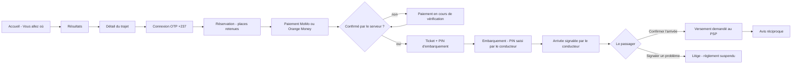
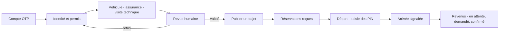

# PRD — Waka, covoiturage interurbain au Cameroun

> Version de travail 0.1 — 21 novembre 2026. « Waka » est un nom de travail (anciennement KÔVO), marque non déposée.
> Ce document décrit un **MVP de pilote**. Il ne constitue ni une validation juridique, ni un agrément de paiement. Le paiement réel est soumis aux portes listées dans [`LEGAL_GATES.md`](./LEGAL_GATES.md) et [`MANQUES_BLOQUANTS.md`](./MANQUES_BLOQUANTS.md).

## Résumé exécutif

| Question | Réponse courte |
|---|---|
| Quoi ? | Une place de marché web mobile-first (PWA) qui met en relation des conducteurs particuliers faisant déjà un trajet interurbain et des passagers cherchant une place. |
| Pour qui ? | Voyageurs et conducteurs des corridors Douala ↔ Yaoundé, puis Kribi, Bafoussam. |
| Différenciation | Double entrée offre + demande, paiement Mobile Money **retenu conditionnellement par un PSP habilité** (pas par Waka), litiges contradictoires et auditables, vérification renforcée des conducteurs. |
| Ce que Waka n'est pas | Ni VTC urbain, ni livraison, ni assureur, ni dépositaire de fonds, ni tribunal. |
| Pilote | 1 corridor (DLA ↔ YDE), 20 à 40 conducteurs vérifiés — hypothèses de recherche, pas des prévisions. |
| Statut | Socle logiciel en construction avec un PSP **MOCK** strictement réservé au développement. Aucun argent réel avant levée des portes GO/NO-GO. |

## 1. Problème

Le trajet Douala → Yaoundé (ou Kribi, Bafoussam) est quotidien pour des milliers de personnes. Des conducteurs font ce trajet avec des sièges vides ; des passagers cherchent une alternative fiable aux agences. La mise en relation reste aujourd'hui fragmentée (contacts personnels, groupes de messagerie, annonces non structurées). Les points de douleur :

| Douleur | Côté passager | Côté conducteur |
|---|---|---|
| Découverte | Trouver un trajet à la bonne heure, au bon point de départ | Remplir ses places sans multiplier les échanges |
| Confiance | Identité du conducteur, état du véhicule, sécurité | Fiabilité du passager, risque de no-show |
| Argent | Payer d'avance sans garantie ; frais opaques | Être payé sans relance ; ne pas subir d'annulations tardives |
| Différends | Aucun recours structuré | Aucune voie pour faire valoir sa version |

## 2. Signaux de marché — l'idée n'est pas nouvelle

Des acteurs locaux existent déjà ; Waka ne prétend pas inventer le covoiturage au Cameroun.

| Acteur | Signal observé (source publique, novembre 2026) | Ce que Waka en retient |
|---|---|---|
| Drivo | Fonctionnalité « Ville à ville », publication de trajets et réservation de places, paiement en espèces à la montée dans la configuration décrite sur son site | La demande existe ; le paiement espèces laisse un espace pour un paiement encadré et traçable |
| Mboa Covoiturage | Autre signal de marché | Concurrence sur l'offre ; la différenciation doit porter sur la confiance |
| CovoiCam | CGU et exigences de vérification consultables | Le niveau d'exigence KYC est un standard attendu, pas un luxe |

Sources : <https://drivo.cm/covoiturage>, <https://covoicam.com/conditions-utilisation> (à titre comparatif, sans reproduction).

## 3. Proposition de valeur

1. **Double entrée** : le conducteur publie une offre ; le passager peut publier une demande et être alerté dès qu'une offre compatible apparaît, avec une explication du score.
2. **Paiement conditionnel vérifiable** : le passager paie via MTN MoMo ou Orange Money auprès d'un PSP habilité ; le versement au conducteur n'intervient qu'après confirmation du passager ou décision de litige — **sous réserve que le contrat PSP le permette**.
3. **Vérification renforcée** : identité, permis, véhicule, assurance, capacité homologuée, revue humaine.
4. **Simplicité locale** : numéros +237, montants entiers en FCFA, repères de rendez-vous réels (carrefours, ronds-points), faible débit.
5. **Transparence** : prix total affiché avant paiement (contribution + frais), politique de litiges publiée, décisions motivées, recours interne.

Promesse de travail : « Le bon trajet. Les bonnes personnes. Un paiement encadré. » — volontairement plus prudente que « votre argent protégé », tant que le mécanisme PSP n'est pas contractualisé.

## 4. Personas

| Persona | Profil type (illustratif) | Objectif | Droits principaux | Restrictions clés |
|---|---|---|---|---|
| **Passager** | Aïcha, 29 ans, commerciale à Douala, se rend à Yaoundé deux fois par mois, Android milieu de gamme | Une place fiable, à l'heure, prix clair | Rechercher, publier une demande, réserver, payer, confirmer, ouvrir un litige, noter | N'agit que sur ses propres réservations ; ne voit aucune pièce d'identité d'autrui |
| **Conducteur** | Serge, 41 ans, cadre, fait DLA → YDE chaque vendredi avec sa berline | Partager les frais sans risque ni relance | Onboarding KYC, véhicule, publication, embarquement PIN, signalement d'arrivée, suivi des revenus | Publication bloquée tant que KYC/véhicule/assurance ne sont pas validés ; ne déclenche jamais seul un versement |
| **Agent support** | Équipe opérations | Répondre vite, collecter les faits | Dossiers **attribués** uniquement, demande de pièces | Ne propose ni n'approuve aucune décision financière |
| **Responsable litiges** | Profil expérimenté, formé à la neutralité | Décider contradictoirement | Tous dossiers, proposition de décision, approbation (d'une décision qu'il n'a pas proposée), revue KYC | MFA obligatoire ; ne peut approuver sa propre proposition |
| **Finance** | Contrôleur financier | Garantir l'exactitude des flux | Rapprochement, exports, exceptions de versement, approbation de décision | Aucune écriture directe dans le ledger ; ne contourne jamais le PSP |
| **Superadmin** | Direction technique | Paramétrer et superviser | Politiques, audit, revue KYC, vue des litiges | **Aucun droit financier implicite** (séparation des tâches) |

Un même compte peut être passager et conducteur ; chaque action est autorisée côté serveur selon le rôle actif et la propriété de l'objet (voir [`SECURITY.md`](./SECURITY.md)).

## 5. Périmètre MVP

### Dans le périmètre

- Web responsive / PWA en français (structure de traduction anglaise en place).
- Trajets **ville à ville** : DLA, YDE, KRI, BFS, LIM, BUE, EDE, BAM, avec points de rendez-vous connus.
- Connexion par OTP +237, onboarding conducteur, véhicules, publication, recherche, demandes passagers, matching explicable.
- Réservation avec verrouillage des places, paiement via abstraction `PaymentProvider` (MOCK en développement), embarquement par PIN, confirmation d'arrivée, litiges, avis.
- Console d'administration séparée : KYC, litiges, paiements, rapprochement, audit, politiques.

### Hors périmètre V1 (non-goals)

| Exclu | Raison |
|---|---|
| VTC urbain à la demande | Autre métier, autre qualification juridique (transport rémunéré) |
| Livraison de colis | Responsabilités et risques distincts |
| Vente ou intermédiation d'assurance | Exige une habilitation ; Waka vérifie l'assurance du conducteur, il ne la vend pas |
| Applications natives Android/iOS | P2, après validation des parcours (FR-24) |
| Matching géospatial sur itinéraire | P2 (FR-23, ADR-010) |
| Paiement en espèces via la plateforme | Incompatible avec la traçabilité recherchée |
| Libération automatique sur silence du passager | Désactivée par défaut tant que non validée (ADR-007) |

## 6. Parcours utilisateurs

### 6.1 Passager — réserver une offre

Règle clé : l'écran « Réservation confirmée » n'apparaît **que** lorsque l'API renvoie `CONFIRMED`, c'est-à-dire après confirmation du PSP vérifiée côté serveur — jamais sur le seul retour du navigateur.

### 6.2 Passager — publier une demande

Exemple : « 2 places Douala → Kribi, samedi 09 h – 12 h, départ Bonabéri si possible, budget 6 000 FCFA ». La demande n'est pas exposée publiquement avec des données personnelles. Le moteur de matching filtre (corridor, statut, éligibilité conducteur, capacité, fenêtre ±2 h, budget +20 %, bagages) puis classe :

`score = 0,40 × time_fit + 0,25 × pickup_fit + 0,20 × reliability + 0,10 × budget_fit + 0,05 × preferences_fit`

Chaque facteur est expliqué en français (« Départ dans votre créneau », « Nouveau conducteur vérifié — pas encore assez d'historique »). Un nouveau conducteur reçoit une fiabilité neutre (0,6), il n'est pas disqualifié. **Aucune réservation automatique.** Version : `match-2026-11-v1`.

### 6.3 Conducteur

Garde-fous : jamais plus de places vendues que de places homologuées et disponibles ; jamais de publication si un document requis est expiré à la date du trajet.

### 6.4 « J'ai un problème »

Disponible dès la réservation : no-show, faux véhicule, comportement dangereux, accident, harcèlement, vol, changement d'itinéraire, panne, erreur de paiement. En cas de danger immédiat, l'application affiche d'abord les consignes d'appel aux secours et aux autorités (numéros à vérifier, voir [`DISPUTES.md`](./DISPUTES.md)) : l'équipe Waka ne remplace ni les urgences ni la police.

## 7. Backlog priorisé

P0 = indispensable au pilote ; P1 = amélioration proche ; P2 = expansion. Le statut d'implémentation est suivi dans le README et la CI, pas dans ce document.

| ID | Prio | Exigence | Critère d'acceptation |
|---|---|---|---|
| FR-01 | P0 | Inscription +237, OTP, sessions sûres | OTP expirant, limitation des tentatives, cookie de session opaque |
| FR-02 | P0 | Profils passager et conducteur | Rôles attribués côté serveur ; statut de vérification visible |
| FR-03 | P0 | KYC conducteur, permis, véhicule, assurance | Aucune publication avant validation humaine/partenaire |
| FR-04 | P0 | Publication et édition de trajet | Prix, date, heure, places et règles validés côté serveur |
| FR-05 | P0 | Recherche ville/date et filtres | Critères exacts, pagination par curseur, résultats stables |
| FR-06 | P0 | Publication de demande passager | Notification des offres correspondantes, désinscription possible |
| FR-07 | P0 | Matching offres/demandes | Score expliqué, pas de réservation automatique |
| FR-08 | P0 | Réservation avec verrouillage des places | Deux paiements concurrents ne peuvent survendre |
| FR-09 | P0 | Paiement PSP MTN/Orange via adaptateur | État confirmé par le serveur après webhook signé vérifié et réinterrogation |
| FR-10 | P0 | Rétention conditionnelle contractuelle PSP | Aucune simulation d'escrow présentée comme réelle |
| FR-11 | P0 | Embarquement et arrivée à deux sources | PIN unique, horodatages, données contestables |
| FR-12 | P0 | Libération après confirmation | Action autorisée, idempotente, vérifiée côté serveur |
| FR-13 | P0 | Litiges, pièces, réponse, décision | Gel de tout versement du dossier litigieux |
| FR-14 | P0 | Remboursement total/partiel via PSP | Calcul explicite, traçabilité, statut final vérifié |
| FR-15 | P0 | Back-office support/finance | MFA, permissions, audit, file des exceptions |
| FR-16 | P0 | Notifications SMS/push/email | Reprise sur échec, aucune donnée sensible dans les SMS |
| FR-17 | P0 | Avis après trajets validés | Un avis par réservation éligible, modération |
| FR-18 | P0 | Conditions, consentement, suppression/export | Consentements versionnés, réponse aux droits |
| FR-19 | P1 | Messagerie interne antifraude | Détection de liens/paiements hors plateforme, signalement |
| FR-20 | P1 | Carte et points de ramassage | Coordonnées vérifiées, lieux connus suggérés |
| FR-21 | P1 | Français/anglais complets | Chaînes traduites, prix XAF, dates locales |
| FR-22 | P1 | Trajets récurrents, favoris | Désactivation possible, places recalculées |
| FR-23 | P2 | Matching géospatial intermédiaire | Détour estimé, points réellement sur l'itinéraire |
| FR-24 | P2 | Applications Android/iOS | Réutilisation des API et parcours validés |
| FR-25 | P2 | Offres entreprises/campus | Compte d'organisation, contrats B2B dédiés |

## 8. Modèle économique (hypothèse non contractuelle)

| Ligne | Exemple (XAF) | Nature |
|---|---:|---|
| Contribution conducteur / place | 5 000 | Due au conducteur, conditionnelle |
| Frais de service Waka | 500 | Revenu brut potentiel, acquis seulement si le trajet est accompli |
| **Total payé par le passager** | **5 500** | Encaissé par le PSP |
| Frais PSP hypothétiques | 100 | À contractualiser — non supposé réel |
| Contribution avant autres charges | 400 | Illustration uniquement, hors TVA et fiscalité |

Politique de frais versionnée (`fees-2026-11-v1`) : 500 FCFA par place, plafond 2 000 FCFA ; contribution de 500 à 50 000 FCFA par place, multiple de 50 ; 1 à 4 places par réservation. Chaque réservation fige un snapshot de prix. Pas de frais cachés.

## 9. KPIs

| KPI | Formule | Usage |
|---|---|---|
| Taux de conversion | réservations payées / recherches qualifiées × 100 | Adéquation offre/demande |
| Taux de remplissage | places réservées et utilisées / places proposées éligibles × 100 | Densité du corridor |
| Taux de paiement réussi | paiements confirmés PSP / tentatives valides × 100 | Qualité du parcours MoMo |
| Taux d'annulation | réservations annulées / réservations confirmées × 100 (ventilé conducteur/passager) | Fiabilité |
| Litiges pour 100 trajets | réservations avec litige / réservations effectuées × 100 | Confiance |
| Résolution dans le SLA | litiges décidés dans le délai cible / litiges décidés × 100 | Qualité du support |
| Délai de versement | confirmation PSP du décaissement − éligibilité réelle | Satisfaction conducteur |
| Taux de rapprochement | transactions rapprochées / transactions attendues × 100 (+ montant des écarts) | Intégrité financière |
| Rétention 30/90 jours | utilisateurs actifs à J+30/J+90 / cohorte × 100 | Valeur durable |
| Marge contributive | frais nets encaissés − frais PSP − remboursements absorbés − coûts variables support/fraude | Unité économique |
| Délai de première réponse support | médiane et p90 | Expérience |
| Incidents de sécurité | nombre et gravité par mois | Risque |

Aucune confusion entre **volume transactionnel** (5 500 FCFA) et **chiffre d'affaires** (500 FCFA au plus).

## 10. Plan de pilote

| Paramètre | Hypothèse de départ | Critère de sortie |
|---|---|---|
| Corridor | Douala ↔ Yaoundé uniquement | Offre et demande mesurées sur 6 à 8 semaines |
| Conducteurs | 20 à 40 vérifiés, recrutés manuellement | ≥ 1 trajet publié par semaine pour une majorité |
| Demande | 100+ recherches qualifiées mesurées | Conversion et compréhension du modèle de paiement mesurées |
| Support | Humain, joignable aux horaires annoncés ; procédure sécurité 24/7 à définir | 10 premiers dossiers résolus et analysés |
| Paiement | Uniquement après GO PSP ; sinon pilote **sans paiement intégré** (mise en relation seule) | Rapprochement sans écart sur la période |
| Arrêt | Incident financier critique ou de sûreté non maîtrisé | Revue post-incident avant reprise |

Ces chiffres sont des **hypothèses de recherche**, pas des prévisions.

## 11. Hypothèses produit non bloquantes (décision par défaut)

| # | Hypothèse | Décision par défaut | Révision |
|---|---|---|---|
| H1 | Les passagers acceptent de payer d'avance si le statut du paiement est explicite (« Fonds gérés par notre partenaire de paiement ») | Paiement à la réservation, hold de places de courte durée, libellés d'état exacts | Si le taux de paiement réussi est < 60 % au pilote, tester un acompte (sous réserve PSP) |
| H2 | Le point de rendez-vous choisi dans une liste de repères connus suffit pour le MVP | Liste fermée de points par ville + texte libre court ; pas de carte interactive (P1) | Si > 10 % des litiges concernent le point de rendez-vous |
| H3 | Les conducteurs acceptent une validation manuelle des réservations ou une acceptation automatique selon leur choix | MVP : réservation instantanée sur trajet publié (le conducteur a été vérifié) ; acceptation manuelle en P1 | Si le taux d'annulation conducteur dépasse 5 % |

## 12. Dépendances et risques produit

- **PSP** : sans capacité de retenue conditionnelle et de versement multi-bénéficiaires, le parcours « payer puis libérer » est bloqué (voir [`PAYMENT_FLOWS.md`](./PAYMENT_FLOWS.md) §10).
- **Transport** : la qualification partage de frais / transport rémunéré conditionne le plafond de contribution et l'éligibilité des conducteurs ([`LEGAL_GATES.md`](./LEGAL_GATES.md)).
- **Assurance** : couverture des passagers à confirmer avec un assureur.
- **Nom** : « Waka » à vérifier (OAPI, domaine) avant toute communication publique.
