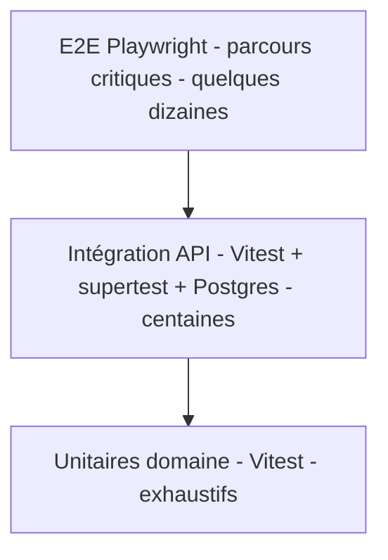

# Plan de test — Waka

> Version de travail 0.1 — 21 novembre 2026. Les statuts ci-dessous reflètent l'état du dépôt à la date de rédaction : les tests du domaine existent (`packages/domain/test/domain.test.ts`) ; les tests d'intégration de l'API (`apps/api/test/`, Vitest, `include: test/**/*.test.ts`) et les tests E2E (`apps/web`, Playwright, `pnpm test:e2e`) sont **en cours d'écriture**. Les noms de fichiers API indiqués sont les noms prévus : vérifier leur présence avant de considérer un scénario couvert.

## Résumé exécutif

- Stratégie en pyramide : beaucoup de **tests unitaires du domaine** (règles pures, rapides, exhaustifs), des **tests d'intégration API** sur une vraie base Postgres (PGlite en local, Postgres réel en CI), un **petit nombre d'E2E** sur le parcours critique.
- Les 15 scénarios obligatoires du cahier (§16.1) sont tous rattachés à un niveau de test et à un emplacement.
- **Concurrence** : PGlite sérialise les connexions ; les tests de course ne sont probants que sur Postgres réel via `TEST_DATABASE_URL` (configuré dans `.github/workflows/ci.yml`).
- Sécurité testée par la suite d'intégration (BOLA/IDOR, webhooks forgés, rejeu, mass-assignment) puis par DAST et pentest indépendant ([`SECURITY.md`](./SECURITY.md) §6).
- Critère de sortie : la check-list « prêt pour un pilote » (§8) est entièrement cochée en environnement **MOCK** — ce qui ne vaut **pas** autorisation de production.

## 1. Pyramide

| Niveau | Outil | Base | Portée | Commande |
|---|---|---|---|---|
| Unitaire domaine | Vitest | Aucune | Machines d'états (toutes transitions), prix, ledger, allocations, RBAC, matching, téléphone | `pnpm --filter @waka/domain test` |
| Intégration API | Vitest + supertest, NestJS en processus | PGlite (défaut) ou Postgres (`TEST_DATABASE_URL`) | Routes, autorisation, transactions, webhooks, outbox, contraintes SQL | `pnpm --filter @waka/api test` |
| Concurrence | Vitest, connexions parallèles | **Postgres réel uniquement** | Dernière place, double confirmation, annulation vs paiement | idem, avec `TEST_DATABASE_URL` |
| Contrat PSP | Vitest | — | Conformité d'un adaptateur à `PaymentProvider` (MOCK aujourd'hui, SANDBOX demain) | à créer avec l'adaptateur |
| Front unitaire | Vitest | — | Formatage FCFA/dates, i18n, composants | `pnpm --filter @waka/web test` |
| E2E | Playwright | API + PGlite seedée | Parcours passager, conducteur, litige | `pnpm test:e2e` |
| Accessibilité | axe (via Playwright) + revue manuelle | — | WCAG 2.2 AA (objectif) | dans la suite E2E |

## 2. Couverture existante du domaine

`packages/domain/test/domain.test.ts` couvre notamment : refus des montants décimaux/négatifs/nuls/hors plafond ; exemple 5 000 + 500 = 5 500 FCFA ; refus **exhaustif** de toute transition non déclarée sur les trois machines ; états terminaux sans sortie ; journaux équilibrés et contre-écriture ; « conducteur arrivé » insuffisant ; litige bloquant ; double confirmation ⇒ un seul ordre ; remboursement > payé refusé ; non-réponse ⇒ revue manuelle par défaut ; mauvais montant ou devise ⇒ anomalie ; support sans droit de décision ; MFA exigée ; superadmin sans droit financier ; séparation des tâches ; filtres et score de matching ; normalisation +237.

## 3. Les 15 scénarios obligatoires (cahier §16.1)

| # | Scénario | Niveau | Emplacement | Statut |
|---|---|---|---|---|
| 1 | Deux utilisateurs tentent de réserver la dernière place : un seul réussit | Concurrence | `apps/api/test/bookings.concurrency.test.ts` (prévu) | À écrire / vérifier |
| 2 | Le PSP envoie trois fois le même webhook : une seule écriture financière, une seule confirmation | Intégration | `apps/api/test/payments.webhooks.test.ts` (prévu) ; clés d'idempotence ledger couvertes en domaine | Domaine ✔ ; API à vérifier |
| 3 | Une page affiche « payé » sans confirmation PSP : la réservation reste en attente | Intégration + E2E | `payments.webhooks.test.ts` (prévu) ; E2E paiement | À écrire / vérifier |
| 4 | Le conducteur se déclare arrivé mais le passager a ouvert un litige : versement bloqué | Unitaire + intégration | `domain.test.ts` (« un litige ouvert bloque la libération ») ; `apps/api/test/release.test.ts` (prévu) | Domaine ✔ ; API à vérifier |
| 5 | Le passager confirme deux fois l'arrivée : un seul ordre de versement | Unitaire + concurrence | `domain.test.ts` (« double confirmation ») ; `release.test.ts` (prévu) | Domaine ✔ ; API à vérifier |
| 6 | Un agent tente de rembourser au-delà du payé : rejet | Unitaire + intégration + base | `domain.test.ts` ; `apps/api/test/disputes.test.ts` (prévu) ; trigger `refunds_within_payment` | Domaine ✔ ; API à vérifier |
| 7 | Un support tente de décider un dossier non autorisé : rejet | Unitaire + intégration | `domain.test.ts` (RBAC/ABAC) ; `disputes.test.ts` (prévu) | Domaine ✔ ; API à vérifier |
| 8 | Un faux document KYC ne peut être marqué validé par le seul client | Intégration | `apps/api/test/driver.kyc.test.ts` (prévu) : aucun schéma d'entrée n'accepte un statut ; seule `kyc:review` décide | À écrire / vérifier |
| 9 | Assurance expirée le jour du trajet : publication et départ bloqués | Intégration | `apps/api/test/trips.eligibility.test.ts` (prévu) | À écrire / vérifier |
| 10 | Annulation concurrente au paiement : issue déterministe, rapprochement cohérent | Concurrence | `bookings.concurrency.test.ts` (prévu) : confirmation tardive sur réservation annulée ⇒ remboursement ou revue manuelle | À écrire / vérifier |
| 11 | Coupure réseau pendant le paiement : reprise sans double facturation | Intégration + E2E | `apps/api/test/idempotency.test.ts` (prévu) : même `Idempotency-Key` ⇒ même paiement | À écrire / vérifier |
| 12 | PSP « succeeded » dans une mauvaise devise ou un mauvais montant : anomalie, jamais confirmation | Unitaire + intégration | `domain.test.ts` (« mauvais montant ou devise ») ; `payments.webhooks.test.ts` (prévu) | Domaine ✔ ; API à vérifier |
| 13 | Relevé PSP différent du ledger : alerte et blocage | Intégration | `apps/api/test/reconciliation.test.ts` (prévu) | À écrire / vérifier |
| 14 | FR/EN, écran 360 px, faible débit, clavier : expérience utilisable | E2E + manuel | `apps/web/e2e/` (prévu) ; matrice §6 | À écrire / vérifier |
| 15 | Suppression des données personnelles limitée par les obligations légales, et explicable | Intégration | `apps/api/test/privacy.test.ts` (prévu) — dépend des durées validées ([`LEGAL_GATES.md`](./LEGAL_GATES.md) D6) | Bloqué par décision juridique |

Scénarios complémentaires financiers (prompt maître, étape 4) : webhooks **hors ordre** (échec après succès), remboursement total puis partiel, litige empêchant le versement, double clic sur « Payer », PSP injoignable pendant la réinterrogation, signature invalide, horodatage hors fenêtre, rejeu avec corps modifié.

## 4. Tests de concurrence

| Principe | Mise en œuvre |
|---|---|
| Base réelle | Les tests de course s'exécutent uniquement si `TEST_DATABASE_URL` est défini ; sinon ils sont **ignorés explicitement** (`skip` avec message) — jamais silencieusement verts sur PGlite |
| Parallélisme effectif | N requêtes lancées simultanément (`Promise.all`) via des connexions distinctes, répétées sur plusieurs itérations |
| Assertions | Exactement 1 succès et N−1 refus `SEATS_UNAVAILABLE` ; `seats_available` jamais négatif ; un seul `payouts` par réservation ; ledger équilibré |
| Invariants post-test | Requêtes SQL de contrôle : somme des lignes ledger par journal = 0, aucune réservation `CONFIRMED` sans paiement `PSP_CONFIRMED_HELD` ou ultérieur |
| CI | Service `postgis/postgis:16-3.4` dans `.github/workflows/ci.yml`, variable `TEST_DATABASE_URL` positionnée |

## 5. E2E (Playwright) — parcours critique

| # | Parcours | Vérifications clés |
|---|---|---|
| E1 | Recherche DLA → YDE sur données seedées | Résultats issus de la base (badge « Démo »), prix total frais inclus |
| E2 | Connexion OTP (`devCode` hors production) | Erreurs en français, limite de tentatives |
| E3 | Réservation + paiement MOCK via le simulateur étiqueté MOCK | « Paiement en cours de vérification » tant que l'API n'a pas renvoyé `CONFIRMED` ; puis ticket + PIN |
| E4 | Échec de paiement MOCK | Message clair, places restituées, aucune confirmation |
| E5 | Conducteur vérifié publie ; conducteur non vérifié refusé | Message explicite pour « Nadège (démo) » |
| E6 | Embarquement PIN, arrivée, confirmation passager | Libellés « Versement demandé » puis « Versement confirmé » distincts |
| E7 | Ouverture de litige | « Litige en cours : règlement suspendu », dossier visible côté admin |
| E8 | Admin : instruction, demande de pièces, proposition de remboursement partiel, approbation par une seconde personne, exécution simulée | Refus si même personne ; audit visible |
| E9 | Support tente de décider | Refus |

## 6. Accessibilité et matrice mobile

| Largeur | Appareil de référence | Points vérifiés |
|---|---|---|
| 360 px | Android d'entrée de gamme | Recherche, résumé de prix lisible, boutons ≥ 44 px, pas de défilement horizontal |
| 390 px | Smartphone courant | Parcours complet de réservation |
| 768 px | Tablette | Mise en page intermédiaire, console admin consultable |
| 1440 px | Ordinateur | Console admin, tableaux de rapprochement |

| Critère | Méthode |
|---|---|
| Navigation clavier complète, focus visible | Playwright + revue manuelle |
| Contrastes WCAG 2.2 AA (palette ajustée si besoin) | axe + vérification manuelle des combinaisons ambre/ivoire |
| Libellés et messages d'erreur associés aux champs | axe |
| Réseau lent (profil « Slow 3G » de Chromium) | Squelettes de chargement, aucun double paiement en cas de lenteur, reprise après coupure |
| FR/EN | Basculer la langue sur chaque écran critique, aucune chaîne cassée, montants « 5 500 FCFA », dates `Africa/Douala` |
| Mode hors ligne | Aucune confirmation de paiement affichée hors ligne |

## 7. Tests de sécurité

| Thème | Tests | Niveau |
|---|---|---|
| BOLA / IDOR | Pour chaque route avec identifiant : accès par un autre passager, un autre conducteur, un support non attribué ⇒ refus | Intégration (`apps/api/test/security.authz.test.ts`, prévu) |
| Autorisation fonctionnelle | Matrice rôle × route admin, MFA absente ⇒ refus | Intégration |
| Mass-assignment | Envoi de `amount`, `paymentStatus`, `commission`, `verified`, `payoutDestination` ⇒ `400` (schémas `.strict()`) | Intégration |
| CSRF | Mutation sans `X-Waka-Request` ⇒ `403` | Intégration |
| Webhook forgé | Signature absente, invalide, calculée sur un JSON re-sérialisé ⇒ `401`, aucune écriture | Intégration |
| Rejeu | Même `event_id` ⇒ aucun effet ; ancien horodatage ⇒ refus | Intégration |
| OTP | Force brute (> 5 tentatives), expiration, rate limit par numéro et IP | Intégration |
| MOCK en production | Démarrage avec `NODE_ENV=production` et `PAYMENT_PROVIDER=mock` ⇒ échec | Intégration |
| Append-only | `UPDATE`/`DELETE` sur ledger ou audit ⇒ exception SQL | Intégration (base) |
| Chaîne d'audit | Altération d'une ligne ⇒ vérification de chaîne en échec | Intégration |
| Statique et dépendances | SAST, `pnpm audit`, gitleaks (déjà présent en CI) | CI |
| Dynamique | DAST sur staging, pentest indépendant | Avant production |

## 8. Check-list « prêt pour un pilote » (prompt maître §9)

À cocher sur environnement MOCK, preuves (captures, logs de test) archivées :

- [ ] Une personne peut rechercher Douala → Yaoundé et parcourir de vrais enregistrements de démonstration issus de la base locale.
- [ ] Un passager peut publier un besoin ; une offre compatible apparaît avec une explication claire du match.
- [ ] Un conducteur vérifié peut créer un trajet ; un conducteur non vérifié ne le peut pas.
- [ ] Réservation en concurrence : la dernière place est attribuée une seule fois (Postgres réel).
- [ ] Paiement MOCK : la réservation n'est confirmée qu'après callback validé ; aucune incohérence après webhook répété ou échec réseau.
- [ ] L'embarquement et l'arrivée modifient les états de manière autorisée.
- [ ] La confirmation passager déclenche une seule libération auprès du prestataire simulé ; un litige ouvert bloque la libération et crée un dossier admin.
- [ ] Un admin habilité peut instruire, demander des pièces, proposer un remboursement partiel, le faire approuver par une autre personne et suivre l'exécution simulée, avec audit.
- [ ] Un support non habilité ne peut déclencher ni remboursement ni versement.
- [ ] Pages, validations, erreurs, paiements et statuts sont compréhensibles en français et utilisables sur téléphone.
- [ ] La check-list GO/NO-GO production existe avec preuves et validations à obtenir ([`LEGAL_GATES.md`](./LEGAL_GATES.md)).

« Prêt pour un pilote » en MOCK ne signifie **pas** prêt pour de l'argent réel : voir [`MANQUES_BLOQUANTS.md`](./MANQUES_BLOQUANTS.md).
